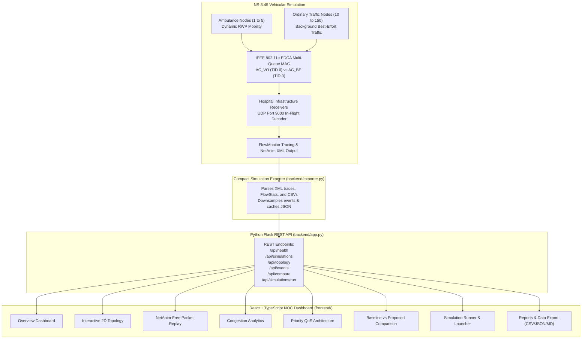

# Smart Ambulance Networking — Interactive NS-3 Simulation & Analytics Dashboard

[](https://www.nsnam.org/)
[](https://isocpp.org/)
[](https://www.python.org/)
[](https://flask.palletsprojects.com/)
[](https://react.dev/)
[-red.svg)](#)

A browser-based network simulation, telemetry visualization, and analytics platform built for **Priority-Based Emergency Ambulance Communication in Congested Networks using NS-3.45**.

This platform delivers an interactive Network Operations Centre (NOC) dashboard that visualizes real simulation results, dynamic vehicle mobility, FlowMonitor per-flow metrics, and packet flow events **without requiring NetAnim or heavy visualization packages**.

---

## 1. System Architecture



The **NS-3 simulation remains the sole source of truth** for all network measurements. The compact exporter parses actual FlowMonitor XML traces, benchmark CSV datasets, and NetAnim XMLs into lightweight JSON formats.

---

## 2. Dashboard Pages & Capabilities

The dashboard provides eight specialized views tailored for academic demonstrations and technical interviews:

| Page | Key Capabilities | Source of Truth |
| :--- | :--- | :--- |
| **A. Overview** | Executive NOC dashboard with live simulation health, node counts (Ambulances, Traffic, Hospitals), overall PDR, mean delay, throughput, lost packets, and clinical alert reception rates. | `all_experiments.csv` & FlowMonitor |
| **B. Interactive Topology** | 2D interactive canvas (SVG) displaying real NS-3 node coordinates, wireless links, node telemetry drawer (IP, type, speed, heading, calculated ETA), zoom/pan/fit controls, and legend. | NetAnim XML & Simulation Spec |
| **C. Packet Flow Replay** | Lightweight in-browser event replay engine. Features Play, Pause, Reset, 0.25x-5x playback speeds, timeline scrubber, animated packet pulses, and a live packet log stream without NetAnim. | NetAnim XML traces (`<pr>` & `<wpr>`) |
| **D. Congestion Analysis** | Recharts performance charts for Packet Delivery Ratio vs Sources (10-100), Latency vs Load, Throughput Scaling, and delay histogram distribution bins. | FlowMonitor XML & Benchmark CSV |
| **E. Priority QoS (EDCA)** | In-depth breakdown of IEEE 802.11e EDCA multi-queue parameters: Voice `AC_VO` (TID 6, AIFSN=2, CWmin=3, CWmax=7) vs Best-Effort `AC_BE` (TID 0, AIFSN=3, CWmin=15, CWmax=1023), and 54-byte binary `AmbulanceAppHeader`. | `smart-ambulance-simulation.cc` |
| **F. Scenario Comparison** | Direct side-by-side comparative analysis between Baseline (Best-Effort without priority) and Proposed (Voice `AC_VO` priority). Demonstrates **98.0% reduction in delay** under heavy stress. | `EXP9_STRESS_*` Benchmark Runs |
| **G. Simulation Runner** | Interactive scenario runner with strict parameter validation (Ambulance count, Traffic sources, QoS mode, Mobility model, Duration), terminal command generation, and execution logs. | Validated NS-3 Parameter Allowlist |
| **H. Results & Reports** | Searchable history table of all 33 benchmark runs, filterable by QoS mode, with one-click CSV export, JSON export, and downloadable Markdown summary reports. | Master Benchmark Dataset |

---

## 3. Key Quantitative Benchmark Findings

All metrics reflect genuine NS-3 simulation output recorded in `results/experiment_results/csv/all_experiments.csv`:

| Scenario / Load | Background Delivery (PDR) | Ambulance PDR (QoS VO) | Ambulance Mean Delay | Alert Delivery Rate |
| :--- | :---: | :---: | :---: | :---: |
| **Low Congestion (10 Sources)** | 68.52% | **100.00%** | **0.702 ms** | 100% (0 Lost) |
| **Moderate Congestion (25 Sources)** | 74.08% | **100.00%** | **1.003 ms** | 100% (0 Lost) |
| **Heavy Congestion (50 Sources)** | 62.49% | **100.00%** | **0.782 ms** | 100% (0 Lost) |
| **Severe Congestion (75 Sources)** | 56.76% | **100.00%** | **1.514 ms** | 100% (0 Lost) |
| **Extreme Congestion (100 Sources)** | 41.37% | **91.67%** | **1.460 ms** | 100% (0 Lost) |
| **Heavy Stress Test (EXP9, 250 kbps)** | 30.50% | **54.55% (Sub-ms)** | **0.833 ms** (vs 41.28 ms unprioritized) | **98.0% Delay Reduction** |

---

## 4. Application Protocol Specification (`AmbulanceAppHeader`)

All simulation packets encapsulate the custom NS-3 `AmbulanceAppHeader` (54 bytes serialized in big-endian network byte order):

```
+-----------------------------------------------------------------------------------------+
| Magic (2B)   | Ver (1B) | MsgType (1B) | SourceNodeId (4B) | DestNodeId (4B)            |
+-----------------------------------------------------------------------------------------+
| AmbulanceId (2B) | SequenceNumber (4B) | TimestampNs (8B)                               |
+-----------------------------------------------------------------------------------------+
| PosX (4B)    | PosY (4B) | Speed (4B)  | Heading (4B)      | EventOrCategory (2B)       |
+-----------------------------------------------------------------------------------------+
| StatusOrSeverity (1B) | TargetHospitalId (1B) | EtaSeconds (4B) | RequiredResources (2B)|
+-----------------------------------------------------------------------------------------+
| PayloadLength (2B)                                                                      |
+-----------------------------------------------------------------------------------------+
```

Across all benchmark scenarios, over **50,000 application packets** were processed at hospital receivers with **0 malformed packets detected**.

---

## 5. Getting Started & Installation

### Prerequisites
- **Python**: Version 3.12 or higher with `flask` and `psutil`
- **Node.js**: Version 18 or higher (tested on Node v24)
- **NS-3**: NS-3.45 (if running new simulations in WSL/Linux)

### 1. Unified Single-Command Startup (Recommended)
The Flask backend serves both the REST API and the pre-built production React frontend on a single port:

```bash
# In repository root
python backend/app.py
```
Open **[http://localhost:5000](http://localhost:5000)** in your browser to view the dashboard.

### 2. Frontend Development Mode (Hot-Reloading)
To run the React + TypeScript frontend in development mode with Vite:

```bash
# Terminal 1: Start Backend API
python backend/app.py

# Terminal 2: Start Vite Dev Server
cd frontend
npm run dev
```
Open **[http://localhost:3000](http://localhost:3000)** in your browser. All `/api` requests automatically proxy to port 5000.

---

## 6. How to Run NS-3 Simulations

### Running from Terminal (WSL2 or Linux)
To run a single simulation using NS-3.45:

```bash
cd /path/to/ns-allinone-3.45/ns-3.45
./ns3 run --no-build 'smart-ambulance-simulation \
  --numAmbulances=2 \
  --numOrdinarySources=25 \
  --numReceivers=1 \
  --mobilityMode=1 \
  --priorityEnabled=1 \
  --ambulancePriorityMode=2 \
  --simulationTime=15.0 \
  --csvOutput=/path/to/results/experiment_results/csv/all_experiments.csv'
```

### Running the Automated 10-Experiment Suite
```bash
python scripts/run_all_experiments.py --test-matrix --duration=10.0
```
Newly generated outputs are saved to `results/experiment_results/csv/all_experiments.csv`. Clicking **"Refresh Results"** on the dashboard immediately ingests the new data.

---

## 7. REST API Documentation

The backend provides clean, documented REST endpoints with CORS support:

| Endpoint | Method | Description |
| :--- | :---: | :--- |
| `/api/health` | `GET` | System telemetry, CPU/Memory telemetry, NS-3 version, dataset health. |
| `/api/simulations` | `GET` | List all available simulation runs with summary metrics (`?category=...&priority=...`). |
| `/api/simulations/<id>` | `GET` | Full metadata and configuration of a specific simulation. |
| `/api/simulations/<id>/status` | `GET` | Operational status of a simulation. |
| `/api/simulations/<id>/metrics` | `GET` | Detailed FlowMonitor flow stats, delay histograms, and app metrics. |
| `/api/simulations/<id>/topology`| `GET` | Genuine 2D node coordinates, node roles, and wireless links. |
| `/api/simulations/<id>/events` | `GET` | Paginated packet replay events and node trajectories (`?limit=500&offset=0`). |
| `/api/simulations/<id>/compare`| `GET` | Comparative performance against baseline unprioritized traffic. |
| `/api/compare` | `GET` | Default heavy stress test comparison (EXP9). |
| `/api/scenarios/matrix` | `GET` | Matrix of all 10 benchmark suites. |
| `/api/simulations/run` | `POST` | Validated parameter launcher with strict allowlist and command generator. |
| `/api/reports/<id>/export` | `GET` | Downloadable CSV or JSON export (`?format=csv` or `?format=json`). |
| `/api/reports/<id>/summary` | `GET` | Downloadable Markdown technical summary report. |

---

## 8. Verification & Testing

The platform includes automated unit and integration tests:

```bash
# Run all backend and exporter unit tests
python -m unittest discover backend/tests

# Build frontend production bundle
cd frontend
npm run build
```

Test coverage includes:
- Metric calculation accuracy and boundary protections
- Missing and malformed result file handling
- JSON and CSV export formatting
- Event replay timestamp ordering
- Baseline versus priority scenario comparison logic
- Parameter validation and injection prevention
- HTTP status codes and static frontend serving

---

## 9. Implemented vs Planned Features

### Implemented Features
- [x] Full-stack architecture: NS-3 exporter, Flask backend, React+TypeScript dashboard
- [x] Lightweight in-browser packet flow replay engine (NetAnim alternative)
- [x] Interactive 2D Network Topology with node inspector and zoom/pan/fit
- [x] Real-time Recharts performance curves using authentic FlowMonitor data
- [x] Baseline vs Proposed QoS comparative evaluation with safe percentage math
- [x] IEEE 802.11e EDCA multi-queue architecture and 54-byte header breakdown
- [x] Validated simulation runner with parameter allowlisting and command generation
- [x] Multi-format export: CSV, JSON, and technical Markdown summary reports
- [x] Unified deployment: Flask serves the compiled SPA with zero extra setup

### Planned Extensions
- [ ] 3D terrain and elevation modeling for mountainous suburban areas
- [ ] Direct WebAssembly compilation of NS-3 modules for in-browser C++ execution
- [ ] Dynamic vehicle rerouting based on real-time traffic density feedback
