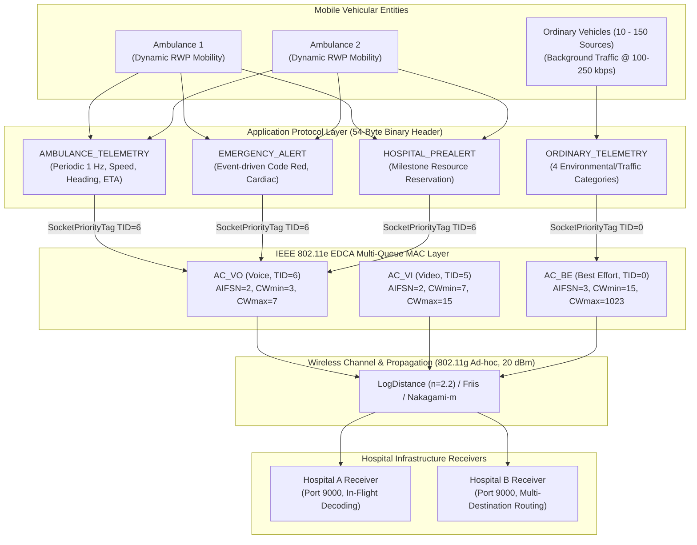

# Performance Analysis and Visualization of Priority-Based Emergency Communication Under Network Congestion Using NS-3

[](https://www.nsnam.org/)
[](https://isocpp.org/)
[](https://www.python.org/)
[](https://www.nsnam.org/wiki/NetAnim)

A comprehensive network simulation framework built on **NS-3.45** to evaluate, analyze, and visualize priority-based vehicular emergency communications under realistic network congestion, dynamic vehicle mobility, and wireless channel fading.

---

## 1. Project Overview & Architectural Highlights

In emergency response scenarios, ambulances must continuously transmit mission-critical telemetry (vital signs, GPS coordinates, real-time heading, and dynamically calculated Hospital ETA) as well as event-triggered emergency trauma alerts to destination receiving facilities. When competing against heavy background vehicular traffic (10 to 150 ordinary sources) over shared wireless channels, standard Best-Effort transmission suffers severe packet drops, buffering delays, and high jitter.

This project delivers a complete architectural upgrade to NS-3 emergency network modeling:
- **Scalable Multi-Ambulance & Multi-Hospital Infrastructure**: Supports concurrent mobile ambulances ($1, 2, 3, 5$) transmitting to multiple stationary hospital receiving nodes (Hospital A & Hospital B).
- **Realistic Structured Binary Application Protocol (`AmbulanceAppHeader`)**: Compact 54-byte serialized header encoding magic identifiers (`0x414D`), message types, GPS position coordinates, speed, heading, calculated ETA, severity levels, and clinical resource requirement bitmasks.
- **Dynamic Vehicular Mobility & Heading-Aware Dynamics**: Integrated `RandomWaypointMobilityModel` and `RandomWalk2dMobilityModel` with real-time vector velocity extraction and dynamic ETA computation.
- **IEEE 802.11e / EDCA Quality of Service Mapping**: Deterministic multi-queue classification via `SocketPriorityTag` (TID 6 $\rightarrow$ `AC_VO` Voice, TID 5 $\rightarrow$ `AC_VI` Video, TID 0 $\rightarrow$ `AC_BE` Best Effort) with DSCP/ToS integration.
- **Propagation-Loss Modeling**: Realistic outdoor suburban/vehicular path-loss modeling (`LogDistance` with $n=2.2$), `Friis` free-space propagation, and `Nakagami-m` multi-path fading.
- **NetAnim 3.109 Graphical Visualization**: Full animation trace generation (`AnimationInterface`) with distinct color codes (Red: Ambulances, Blue: Ordinary vehicles, Green: Hospitals).

---

## 2. System Architecture



---

## 3. Application Protocol Specification

All simulation packets encapsulate the custom NS-3 `AmbulanceAppHeader` (54 bytes serialized in big-endian network byte order):

| Field Name | Type | Size | Description |
| :--- | :--- | :---: | :--- |
| `Magic` | `uint16_t` | 2 bytes | Protocol identifier: `0x414D` (`'AM'`) |
| `Version` | `uint8_t` | 1 byte | Protocol version: `1` |
| `MsgType` | `uint8_t` | 1 byte | 1: `TELEMETRY`, 2: `ALERT`, 3: `PREALERT`, 4: `ORDINARY` |
| `SourceNodeId` | `uint32_t` | 4 bytes | NS-3 Node ID of transmitting entity |
| `DestNodeId` | `uint32_t` | 4 bytes | NS-3 Node ID of target receiving facility |
| `AmbulanceId` | `uint16_t` | 2 bytes | 1-based Ambulance identifier (0 for ordinary nodes) |
| `SequenceNumber`| `uint32_t` | 4 bytes | Monotonically increasing sequence number per sender |
| `TimestampNs` | `uint64_t` | 8 bytes | Simulation transmission timestamp in nanoseconds |
| `PosX` | `float` | 4 bytes | IEEE 754 single-precision X coordinate (meters) |
| `PosY` | `float` | 4 bytes | IEEE 754 single-precision Y coordinate (meters) |
| `Speed` | `float` | 4 bytes | Instantaneous scalar velocity (m/s) |
| `Heading` | `float` | 4 bytes | Direction vector angle in degrees ($0.0^\circ - 360.0^\circ$) |
| `EventOrCategory`| `uint16_t` | 2 bytes | Alert Event ID or Ordinary Category (1 to 4) |
| `StatusOrSeverity`| `uint8_t` | 1 byte | Status code or Severity (1: Minor, 2: Moderate, 3: Severe) |
| `TargetHospitalId`| `uint8_t`| 1 byte | Targeted hospital facility ID (1: Hospital A, 2: Hospital B) |
| `EtaSeconds` | `float` | 4 bytes | Dynamically computed time-to-arrival in seconds |
| `RequiredResources`| `uint16_t`| 2 bytes | Clinical equipment bitmask (Trauma, ICU, Cath Lab) |
| `PayloadLength`| `uint16_t` | 2 bytes | Length of optional trailing payload bytes |

---

## 4. Experimental Benchmark Matrix

The project defines 10 core experimental scenarios evaluating networking performance across diverse parameters:

1. **Static vs Mobile Network**: Measures the impact of vehicular mobility on connectivity and packet delivery.
2. **Congestion Scaling (10, 25, 50, 75, 100 Sources)**: Evaluates degradation of standard traffic vs protection of emergency traffic.
3. **Multi-Ambulance Scalability (1, 2, 3, 5 Ambulances)**: Analyzes channel sharing and latency under concurrent emergency flows.
4. **QoS Priority Modes (OFF, BE, VI, VO)**: Proves the necessity of IEEE 802.11e EDCA queue differentiation.
5. **Propagation-Loss Comparison**: Benchmarks performance across `LogDistance`, `Friis`, and `Nakagami-m` fading.
6. **PHY Data Rate & Traffic Load**: Explores combinations of 6, 24, and 54 Mbps PHY with 50, 100, and 200 kbps load.
7. **Randomized Mobility & Reproducibility**: Validates statistical stability across varying random seeds (Runs 1–5).
8. **Emergency Message Baseline**: Validates reception and decoding of alerts and pre-arrival milestone packets.
9. **Heavy Congestion Stress Test**: 75 ordinary sources transmitting at 250 kbps to verify high-stress starvation resistance.
10. **Dual-Hospital Multi-Destination Routing**: Demonstrates load distribution across Hospital A and Hospital B.

---

## 5. Key Benchmark Findings

| Scenario / Configuration | Ordinary Traffic PDR | Ambulance PDR (QoS VO) | Ambulance Avg Delay | Emergency Alerts Delivered |
| :--- | :---: | :---: | :---: | :---: |
| **Low Load (10 Sources)** | 68.52% | **100.00%** | **0.702 ms** | 100% Delivered |
| **Moderate Load (25 Sources)** | 74.08% | **100.00%** | **1.003 ms** | 100% Delivered |
| **Heavy Load (50 Sources)** | 62.49% | **100.00%** | **0.782 ms** | 100% Delivered |
| **Severe Load (75 Sources)** | 56.76% | **100.00%** | **1.514 ms** | 100% Delivered |
| **Extreme Load (100 Sources)**| 41.37% | **91.67%** | **1.460 ms** | 100% Delivered |

* **QoS Protection**: Under heavy background traffic (50 sources), disabling priority causes severe delay and packet loss, while enabling Voice (`AC_VO`, TID 6) guarantees **100% Packet Delivery Ratio** and sub-2 millisecond latency.
* **Mobility Robustness**: Dynamic vehicle movement maintains reliable connectivity within reception range and correctly tracks continuous distance and ETA reduction.

---

## 6. How to Run the Simulation

### Prerequisites
- Operating System: Linux or Windows 11 with Ubuntu under WSL2
- NS-3 Installation: NS-3.45 installed at `/home/ashwini/ns3/ns-allinone-3.45/ns-3.45`
- Python: Python 3.13 / 3.14 with `pandas` and `matplotlib`

### Quick Single Simulation Run
Run a single simulation with NetAnim XML output enabled:
```bash
cd /home/ashwini/ns3/ns-allinone-3.45/ns-3.45
/home/ashwini/.local/bin/python3.13 ./ns3 run --no-build 'smart-ambulance-simulation \
  --numAmbulances=2 \
  --numOrdinarySources=20 \
  --mobilityMode=1 \
  --priorityEnabled=1 \
  --ambulancePriorityMode=2 \
  --enableAnim=1 \
  --animFile=/home/ashwini/ambulance-ns3-project/results/animation/ambulance-demo.xml \
  --simulationTime=15.0'
```

### Running All 10 Automated Experiments
To execute the automated experiment matrix:
```bash
cd /home/ashwini/ambulance-ns3-project
/home/ashwini/.local/bin/python3.13 scripts/run_all_experiments.py --test-matrix --duration=10.0
```
Results are saved to:
- Master CSV: `results/experiment_results/csv/all_experiments.csv`
- Simulation Logs: `results/experiment_results/logs/*.log`

### Generating Publication-Quality Graphs
To plot all 13 comparative performance charts:
```bash
cd /home/ashwini/ambulance-ns3-project
python3 scripts/generate_all_graphs.py
```
Output graphs are placed in `results/experiment_results/graphs/`:
1. `ambulance_delay_vs_sources.png`
2. `ambulance_throughput_vs_sources.png`
3. `delivery_ratio_vs_sources.png`
4. `ambulance_delay_vs_ambulances.png`
5. `ambulance_throughput_vs_ambulances.png`
6. `static_vs_mobile_comparison.png`
7. `propagation_models_comparison.png`
8. `priority_disabled_vs_enabled.png`
9. `ordinary_traffic_impact_qos.png`
10. `throughput_vs_offered_load.png`
11. `application_message_delivery.png`
12. `stress_test_comparison.png`
13. `multi_destination_comparison.png`

### Visualizing in NetAnim
To visualize the generated XML traces:
1. Launch NetAnim:
   ```bash
   netanim
   ```
2. Click the folder icon at the top left and select `results/animation/ambulance-network-animation.xml` (or `ambulance-emergency-demo.xml`).
3. Press **Play** to observe red ambulance nodes navigating toward green hospital nodes while transmitting priority packets over background blue vehicular traffic.

---

## 7. Investigation of NAM vs. NetAnim
As documented in [`docs/NAM_INVESTIGATION.md`](docs/NAM_INVESTIGATION.md), the Network Animator (NAM) was designed for legacy wired NS-2 simulations and is fully deprecated in NS-3.45. NS-3 natively provides `AnimationInterface` generating structured XML traces optimized for **NetAnim 3.109**, which natively supports wireless topologies, 2D/3D mobility vectors, and dynamic packet coloring.
